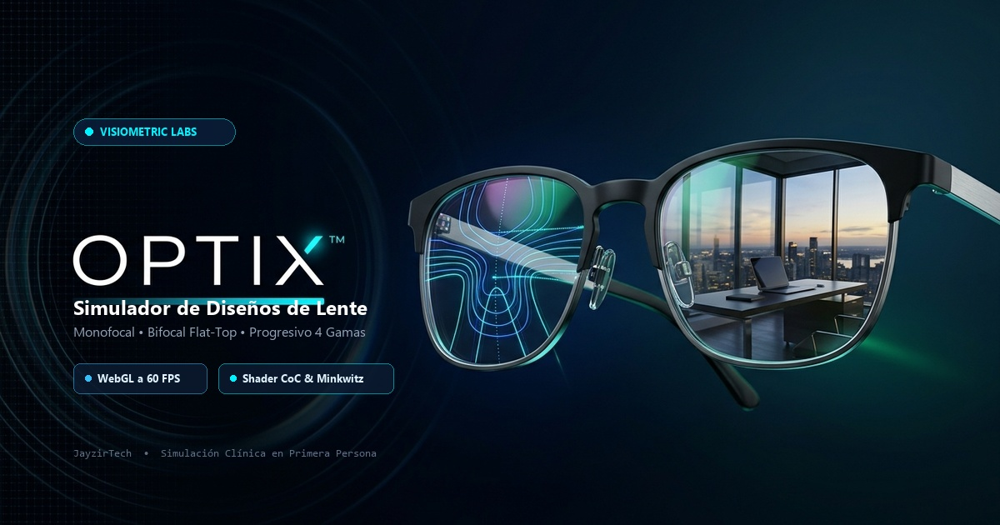

# Optix™ by Visiometric Labs 📐👓

> **Simulador Clínico e Interactivo de Diseños de Lente Oftálmica según Campos Visuales y Distancias Focales**  
> *Monofocales (Lejos / Cerca) • Bifocales Flat-Top 28 • Progresivos Continuos de 4 Gamas*  
> Desarrollado por **JayzirTech** para **Visiometric Labs**.

<p align="center">
  <a href="README.md"><strong>🇪🇸 Versión en Español</strong></a> • 
  <a href="README_EN.md"><strong>🇺🇸 English Version</strong></a>
</p>

<p align="center">
  <a href="https://visiometric-labs.github.io/focal_lengths-simulator/"></a>
  <a href="https://visiometric-labs.github.io/focal_lengths-simulator/"></a>
  
  
  
</p>

<p align="center">
  
</p>

---

## 🎯 Descripción General

**Optix™** es una plataforma clínica de simulación óptica en primera persona (POV) renderizada en tiempo real mediante shaders WebGL a 60 FPS, diseñada específicamente para ópticas, consultorios optométricos y mostradores de atención al paciente présbita.

A diferencia de los métodos comerciales tradicionales basados en diagramas estáticos o folletos impresos, **Optix™ permite al paciente experimentar directamente a través de una montura oftálmica realista** el comportamiento físico, las distancias focales y las limitaciones ópticas de cada diseño de lente: **Monofocales** (Lejos / Cerca), **Bifocales Flat-Top 28** (con salto de imagen y punto ciego intermedio) y **Lentes Progresivos continuos de 4 gamas** (evidenciando el Teorema de Minkwitz y el ensanchamiento ergonómico del corredor útil).

---

## 👓 El Ecosistema Visiometric Labs (Las 4 Aplicaciones)

Optix™ forma parte de la suite clínica especializada desarrollada por **JayzirTech**:

| Simulador | Nombre Clave | Enfoque Principal | Tecnología Clave |
| :--- | :--- | :--- | :--- |
| **Refracción y Anatomía** | `Ocularis` | Diagnóstico de miopía, hipermetropía, astigmatismo y presbicia | Canvas 2D Photonic Ray Tracing (60 FPS) |
| **Campos Focales y Diseños** | `Optix` | Monofocales, Bifocales Flat-Top y Progresivos en 4 gamas | WebGL 2D Shaders + Mapa de Profundidad 3 planos |
| **Filtros y Tratamientos** | `Chromatis` | Antirreflejo Verde, Crizal 5 en 1, Blue Cut, DriveSafe, Polarizado | Dual-Pass Canvas POV + Escenas 2K Calibradas |
| **Lentes Fotosensibles** | `Luminix` | Transitions® Signature Gen S, XTRActive y Style Mirrors | Three.js WebGL + Avatar 3D (Ready Player Me) + POV |

---

## 🎯 Propósito Clínico y Pedagógico

En la consulta optométrica y en el mostrador de ventas de la óptica, la elección del diseño de lente genera las mayores dudas e incertidumbres en pacientes présbitas:

| Diseño | Pregunta clásica del paciente |
|---|---|
| **Monofocal** | *«¿Por qué con mis gafas de lectura no puedo ver la televisión sin que se nuble todo?»* |
| **Bifocal** | *«¿Por qué veo borroso el monitor del computador si leo perfecto el celular abajo?»* |
| **Progresivo** | *«¿Por qué un amigo me dijo que los multifocales marean al mover los ojos a los lados?»* |

**Optix™** responde a estas preguntas **en primera persona**: el paciente experimenta directamente, a través de una montura oftálmica realista renderizada en WebGL, cómo se comporta cada diseño óptico frente a las distancias de la vida cotidiana.

---

## 👓 Diseños Oftálmicos Implementados

### 1. Lente Monofocal (Potencia Dióptrica Homogénea)
- Potencia constante en toda la superficie del cristal, libre de aberraciones cilíndricas marginales.
- **Modo Lejos (>3 m):** Fondo de la oficina y skyline nítidos; laptop y celular profundamente desenfocados.
- **Modo Cerca (~35 cm):** Lectura de celular y libreta nítidos; fondo de oficina desenfocado para ilustrar el mareo al caminar con gafas de lectura.

### 2. Lente Bifocal Flat-Top 28
- Dos campos focales separados por una línea recta horizontal con medialuna inferior de 28 mm (D-Shape anatómica).
- **Zona superior:** Enfoque a infinito (fondo y skyline nítidos).
- **Pastilla inferior (D-Shape 28 mm):** Enfoque próximo (~35 cm).
- **El Salto de Imagen (*Image Jump*):** Desplazamiento prismático vertical instantáneo al cruzar el borde superior de la pastilla debido a la discontinuidad de centro óptico.
- **El Punto Ciego Intermedio:** La zona del computador y el teclado (~70 cm) queda borrosa tanto arriba como abajo, evidenciando por qué el bifocal es inadecuado para trabajar en pantallas digitales.

### 3. Lente Progresivo / Multifocal (4 Gamas)
- Gradación dióptrica suave, continua y vertical (sin líneas divisorias ni saltos prismáticos).
- **Física del Teorema de Minkwitz:** Toda adición dióptrica vertical genera inevitablemente astigmatismo marginal a los lados del pasillo.
- **Selector de 4 gamas** con ensanchamiento progresivo del corredor útil:

| Gama | Corredor Útil | Aberraciones Laterales | Sensación Clínica |
|---|---|---|---|
| **Básica (Tradicional)** | ~30% | Notorias y tempranas | Exige giros marcados de cuello para enfocar pantallas |
| **Media (Digital Convencional)** | ~45% | Moderadas y suavizadas | Adaptación balanceada para uso en oficina |
| **Media Alta (Free-Form)** | ~65% | Reducidas y ergonómicas | Corredor amplio, transiciones suaves y menor balanceo |
| **Alta (Personalizado Premium)** | ~85% | Mínimas en bordes extremos | Máxima libertad de movimiento ocular natural |

---

## ⚡ Arquitectura Técnica y Shader WebGL

A diferencia de simuladores basados en fotos estáticas alternadas, **Optix™ usa una única imagen maestra nítida y calcula el desenfoque en tiempo real** mediante un fragment shader GLSL ejecutado en la GPU a 60 FPS.

```
┌─────────────────────────────────────────────────────────┐
│                   GPU (Fragment Shader)                  │
│                                                         │
│  Textura 0: Escena 4K (skyline-workstation-4k.jpg)      │
│  Textura 1: Mapa de Profundidad (depth.png)             │
│  Textura 2: Máscara de Apertura Binocular (generada)    │
│                                                         │
│  Uniforms: u_camera, u_lensType, u_subMode,             │
│            u_overlayActive, u_resolution, u_aspect       │
│                                                         │
│  ➜ Cálculo CoC (Circle of Confusion) por píxel          │
│  ➜ Muestreo Bokeh con Espiral Dorada (12 muestras)      │
│  ➜ Aberración lateral Minkwitz para progresivos          │
│  ➜ Salto prismático para bifocales                       │
│  ➜ Visión periférica presbita fuera de las gafas         │
└─────────────────────────────────────────────────────────┘
```

### Fórmula del Circle of Confusion (CoC)

Para cada píxel, el shader calcula:

$$\text{CoC} = |Z_{\text{pixel}} - F_{\text{lens}}| \times 28 + \text{Aberración}_{\text{lateral}} \times 24$$

Donde:
- $Z_{\text{pixel}}$ = profundidad real del píxel (leída del mapa de profundidad)
- $F_{\text{lens}}$ = distancia focal objetivo del lente en ese punto de la montura
- $\text{Aberración}_{\text{lateral}}$ = astigmatismo marginal fuera del corredor (solo progresivos, según el Teorema de Minkwitz)

### Escena Maestra y Mapa de Profundidad 4K

| Asset | Resolución | Formato | Descripción |
|---|---|---|---|
| `skyline-workstation-4k.jpg` | 3840 × 2160 | JPEG 98% | Panorama AI-expandido de escritorio ejecutivo con skyline urbano sin bordes espejados |
| `skyline-workstation-depth.png` | 3840 × 2160 | PNG 8-bit grayscale | Mapa de profundidad calibrado por zona fotométrica |

**Rangos de profundidad del mapa:**

| Zona de la Escena | Valor (0-255) | Profundidad normalizada |
|---|---|---|
| Cielo abierto | ~247 | 0.97 (infinito) |
| Skyline / rascacielos | ~232 | 0.91 |
| Pantalla del laptop | ~187 | 0.73 |
| Teclado | ~80 | 0.31 |
| Escritorio (borde inferior) | ~58 | 0.23 |
| Objetos cercanos (libreta, tablet, taza) | ~40-55 | 0.16-0.22 |

---

## ⌨️ Controles y Navegación de Mirada (POV)

| Control / Interacción | Acción Realizada |
| :--- | :--- |
| **Arrastre (Táctil / Ratón)** | Navegación de la mirada POV con inercia física, fricción y límites fisiológicos de cuello (Yaw ±0.88, Pitch +1.05 / -1.15). |
| **Doble Toque / Botón Centrar** | Recentrado inmediato de la mirada al punto neutro frontal. |
| **Selector Inferior** | Cambio de diseño oftálmico (Monofocal, Bifocal, Progresivo) y gamas de corredor. |
| **Botón Mapa Óptico** | Activa el modo Rayos X para visualizar el corredor de Minkwitz o la pastilla Flat-Top. |
| **Botón Pantalla Completa** | Alternar modo inmersivo a pantalla completa. |
| **Clic en Logo Optix™** | Regresar a la portada de bienvenida (preservando pantalla completa en kiosco). |

---

## 🏛️ Estructura del Proyecto

```
focal_lengths-simulator/
├── .github/
│   └── workflows/
│       └── deploy.yml                 # CI/CD: Build Vite + Deploy a GitHub Pages (rama main)
├── docs/
│   └── assets/
│       └── optix-office-reference.jpg # Imagen de referencia de la escena original
├── public/
│   ├── manifest.json                  # PWA Web App Manifest (fullscreen, any orientation)
│   ├── branding/
│   │   ├── favicon.svg                # Favicon vectorial SVG (Gafas POV Split)
│   │   ├── favicon-opt1.png           # Favicon PNG 32×32
│   │   ├── apple-touch-icon.png       # Apple Touch Icon 180×180
│   │   └── og-cover.jpg              # Open Graph 3D / WhatsApp / LinkedIn 1200×630
│   └── scenes/
│       ├── skyline-workstation-4k.jpg  # Escena maestra 4K panorámica (AI-expandida)
│       ├── skyline-workstation-depth.png # Mapa de profundidad calibrado 4K
│       ├── office-master.jpg           # Escena original 2.7K (legado)
│       └── office-depth.png            # Mapa de profundidad original (legado)
├── scripts/
│   ├── generate-depth-map.cjs         # Generador de mapa de profundidad (Node + Sharp)
│   ├── generate-branding.cjs          # Generador de favicon vectorial
│   └── generate-og-cover.py           # Pipeline generador de og-cover 1200×630
├── src/
│   ├── main.js                         # Orquestador maestro de la aplicación
│   ├── components/
│   │   ├── preloader.js               # Preloader dinámico circular con spinner SVG fotónico
│   │   ├── landing-screen.js          # Portada de bienvenida y gestión de fullscreen
│   │   ├── glasses-hud.js             # Montura oftálmica binocular SVG en primera persona
│   │   ├── hud-header.js              # Cabecera HUD: logo, Mapa Óptico, Centrar, Fullscreen
│   │   ├── lens-selector.js           # Selector de diseño y gama con iconografía SVG pura
│   │   └── experience-card.js         # Ficha explicativa clínica del paciente (colapsable)
│   ├── core/
│   │   ├── camera-controller.js       # Controlador cinemático POV con inercia y lerp
│   │   ├── event-bus.js               # Bus de eventos desacoplado (pub/sub)
│   │   ├── idle-manager.js            # Temporizador de inactividad (5 min / override URL)
│   │   ├── asset-helper.js            # Resolución universal de URLs (Vite, GH Pages, relativo)
│   │   └── lenses-data.js            # Especificaciones clínicas de los 3 diseños y 4 gamas
│   ├── engine/
│   │   ├── webgl-renderer.js          # Motor WebGL: texturas, quad, uniforms y render loop
│   │   └── shaders/
│   │       ├── focal-vertex.glsl      # Vertex shader: coordenadas UV de pantalla completa
│   │       └── focal-fragment.glsl    # Fragment shader: CoC, Bokeh, Minkwitz, Image Jump
│   └── styles/
│       ├── theme.css                  # Design system médico oscuro (colores, tipografía)
│       ├── layout.css                 # Layout de viewport, canvas y capas HUD
│       ├── landing.css                # Estilos del preloader y la portada de bienvenida
│       └── components.css             # Selectores, tarjetas, píldoras y botones HUD
├── index.html                          # Documento HTML principal con metadatos SEO/OG
├── package.json                        # Dependencias: Vite 6, Sharp (dev)
└── vite.config.js                      # Configuración Vite: base dinámica, ES2020, puerto 3000
```

---

## 🚀 Instalación y Desarrollo Local

### Requisitos
- **Node.js** ≥ 18 (recomendado v22)
- **npm** ≥ 9

### Instalación

```bash
git clone https://github.com/visiometric-labs/focal_lengths-simulator.git
cd focal_lengths-simulator
npm install
```

### Servidor de Desarrollo

```bash
npm run dev
```

Abre `http://localhost:3000` en tu navegador. Vite ofrece HMR (Hot Module Replacement) instantáneo.

### Build de Producción

```bash
npm run build
```

Genera el bundle optimizado en `dist/` con base path `/focal_lengths-simulator/` para GitHub Pages.

### Preview del Build

```bash
npm run preview
```

---

## 🌐 Despliegue (CI/CD)

El proyecto se despliega automáticamente en **GitHub Pages** mediante GitHub Actions:

1. **Trigger:** Cada push a la rama `main` (o dispatch manual).
2. **Build:** `npm ci && npx vite build --base=/focal_lengths-simulator/`
3. **Deploy:** `actions/deploy-pages@v4` publica el directorio `dist/`.

**URL de producción:** https://visiometric-labs.github.io/focal_lengths-simulator/

### Flujo de Ramas

```
dev ──────────────────► main (merge) ──────► GitHub Pages (auto-deploy)
  (desarrollo activo)      (producción)          (CI/CD Action)
```

---

## 🎛️ Flujo de la Aplicación y Modo Kiosco

```
Preloader Circular ──► Portada de Bienvenida ──► Simulador POV (WebGL + HUD)
   (precarga GPU)         (Landing Screen)           (Experiencia Interactiva)
                              │                              │
                              │  «Iniciar Experiencia»       │  Arrastrar = Mover mirada
                              │  → requestFullscreen()       │  Selector inferior = Cambiar lente
                              │                              │  Mapa Óptico = Rayos X toggle
                              │                              │  Logo = Volver a portada
                              │                              │
                              │◄──── Inactividad 5 min ──────│
                              │◄──── Clic en Logo ───────────│
```

### Modo Mostrador / Kiosk
- Tras **5 minutos** de inactividad, la app regresa automáticamente a la portada de bienvenida restableciendo la cámara al centro.
- **Preservación de Pantalla Completa:** Mantiene la pantalla completa activa para no interrumpir el modo mostrador.
- **Parámetro de Testing Inmediato:** Añade `?timeout=2000` a la URL para validar el temporizador en 2 segundos.

---

## 🎨 Identidad Visual

| Elemento | Especificación |
|---|---|
| **Nombre de marca** | Optix™ by Visiometric Labs |
| **Favicon** | Gafas POV Split con doble foco (SVG vectorial) |
| **Tipografías** | Plus Jakarta Sans (UI) + JetBrains Mono (datos técnicos) |
| **Paleta** | Fondo abisal `#070F1E`, cian fotónico `#00F2FE`, azul clínico `#38BDF8` |
| **Iconografía** | 100% SVG vectorial — cero emojis en la interfaz |
| **Open Graph** | Tarjeta 3D cinemática 1200 × 630 px con busting de caché `?v=2` |

---

## ✅ Criterios de Calidad

| Criterio | Estado |
|---|---|
| Renderizado a 60 FPS en desktop y tablets | ✅ |
| Pantalla completa automática al iniciar | ✅ |
| Preloader circular dinámico SVG | ✅ |
| Modo mostrador con retorno automático tras 5 min | ✅ |
| Monofocal: imposibilidad de enfocar dos distancias | ✅ |
| Bifocal: Image Jump + punto ciego intermedio | ✅ |
| Progresivo: 4 gamas con ensanchamiento de corredor | ✅ |
| Mapa de profundidad calibrado a la escena 4K real | ✅ |
| Escena panorámica AI-expandida sin bordes espejeados | ✅ |
| Iconografía SVG pura (cero emojis) | ✅ |
| Cero menciones a precios en la UI | ✅ |
| DPR limitado a 2.0 para rendimiento térmico | ✅ |
| Tolerancia a pérdida de contexto WebGL | ✅ |
| PWA manifest con `display: fullscreen` | ✅ |
| Metadatos OG completos para redes sociales con caché v2 | ✅ |
| CI/CD automático en GitHub Pages | ✅ |

---

## 📝 Historial de Cambios

| Commit | Descripción |
|---|---|
| `d5b6e94` | Actualización de og-cover a render 3D de alta definición y caché v2 |
| `4659f64` | Documentación completa bilingüe (README, README_EN, AI_CONTEXT) |
| `98e466b` | Mapa de profundidad alineado con la escena real 4K (v6) |
| `5b1df62` | Panorama AI-expandida sin espejeado lateral + pitch extendido |
| `6ddad92` | Vista completa del escritorio + mapa de profundidad de precisión |
| `0de45f3` | Outpainting lateral y vertical 4K con POV calibrado |
| `0945a3b` | Profundidad fotométrica de precisión (ventana, laptop, objetos cercanos) |
| `946dec3` | Escena definitiva 4K skyline con mapa de profundidad focal |
| `0bc5f17` | Pastillas bifocales más amplias para lectura cómoda |
| `2fb2449` | Pastillas D-shape confinadas 100% al interior del marco |
| `aacd18e` | Escena panorámica 2.7K con rango POV extendido |
| `bbc1499` | 9 puntos de feedback clínico y ergonómico resueltos |
| `f97d188` | Implementación completa del simulador WebGL + HUD clínico |
| `11ef39c` | Setup inicial del proyecto, CI y documentación conceptual |

---

## 🏢 Autoría y Propiedad Intelectual

- **Organización:** Visiometric Labs
- **Empresa Matriz / Titular de Derechos:** JayzirTech
- **Portafolio:** [JayzirTech Portfolio](https://jayzirtech.github.io/portfolio_JayzirTech/)
- **LinkedIn:** [Jayzir Martínez](https://linkedin.com/in/jayzir-martinez)
- **Licencia:** Privada / Todos los derechos reservados © 2026
