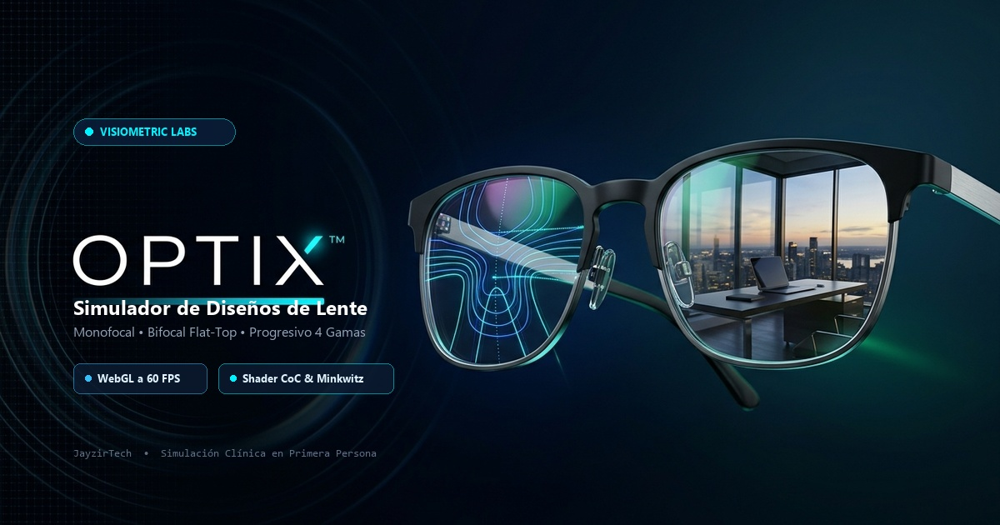

# Optix™ by Visiometric Labs 📐👓

> **Interactive Clinical Simulator for Ophthalmic Lens Designs across Visual Fields and Focal Distances**  
> *Single Vision (Distance / Near) • Bifocal Flat-Top 28 • Progressive (Multifocal) Lenses across 4 Quality Tiers*  
> Engineered by **JayzirTech** for **Visiometric Labs**.

<p align="center">
  <a href="README.md"><strong>🇪🇸 Versión en Español</strong></a> • 
  <a href="README_EN.md"><strong>🇺🇸 English Version</strong></a>
</p>

<p align="center">
  <a href="https://visiometric-labs.github.io/focal_lengths-simulator/"></a>
  <a href="https://visiometric-labs.github.io/focal_lengths-simulator/"></a>
  
  
  
</p>

<p align="center">
  
</p>

---

## 🎯 Executive Overview

**Optix™** is a clinical-grade, first-person point-of-view (POV) optical simulation platform rendered in real-time via WebGL shaders at 60 FPS, purpose-built for optical retail displays, optometric consulting rooms, and presbyopic patient decision-making counters.

Unlike legacy commercial demonstrations relying on static comparative photos or printed brochures, **Optix™ allows patients to directly experience, through a realistic eyeglass frame**, the physical behavior, focal zones, and optical boundaries of each ophthalmic design: **Single Vision** (Distance / Near), **Bifocal Flat-Top 28** (demonstrating image jump and the intermediate computer blind spot), and **Progressive lenses across 4 tiers** (visualizing the Minkwitz Theorem and progressive corridor widening).

---

## 👓 The Visiometric Labs Ecosystem (The 4 Applications)

Optix™ belongs to the specialized clinical suite engineered by **JayzirTech**:

| Simulator | Codename | Core Medical Focus | Key Technology |
| :--- | :--- | :--- | :--- |
| **Refraction & Anatomy** | `Ocularis` | Myopia, hyperopia, astigmatism & presbyopia diagnosis | Canvas 2D Photonic Ray Tracing (60 FPS) |
| **Focal Fields & Designs** | `Optix` | Single Vision, Bifocal Flat-Top & 4 Progressive Tiers | WebGL 2D Shaders + 3-plane Depth Map |
| **Filters & Coatings** | `Chromatis` | Green AR, Crizal 5-in-1, Blue Cut, DriveSafe, Polarized | Dual-Pass Canvas POV + Calibrated 2K Scenery |
| **Photochromic Lenses** | `Luminix` | Transitions® Signature Gen S, XTRActive & Style Mirrors | Three.js WebGL + 3D Avatar + POV Gaze |

---

## 🎯 Clinical & Pedagogical Purpose

In optometric practice and optical retail dispensing, lens design selection creates significant confusion and anxiety for presbyopic patients:

| Design | Classic Patient Dilemma |
|---|---|
| **Single Vision** | *"Why can't I watch TV with my reading glasses without everything going blurry and nauseating?"* |
| **Bifocal** | *"Why is my computer screen completely blurry if I can read my phone clearly in the bottom segment?"* |
| **Progressive** | *"Why did my friend say multifocal glasses make you dizzy when you look sideways?"* |

**Optix™** answers these questions **in first person**: the patient directly experiences, through a realistic WebGL eyeglass frame, how each optical geometry behaves across real-world distances.

---

## 👓 Implemented Lens Designs

### 1. Single Vision Lens (Homogeneous Dioptric Power)
- Constant refractive power across the entire lens surface, free from lateral astigmatism.
- **Distance Mode (>3 m):** Background office and skyline sharp; laptop and phone heavily blurred.
- **Near Mode (~35 cm):** Phone and notebook crisp; background blurred to demonstrate why walking with reading glasses causes disorientation.

### 2. Bifocal Flat-Top 28
- Two focal fields separated by a sharp horizontal boundary with an anatomical 28 mm D-shape segment.
- **Upper Zone:** Distance infinity focus (skyline sharp).
- **Lower Segment (Flat-Top 28):** Near reading focus (~35 cm).
- **Image Jump:** Abrupt vertical prismatic displacement when crossing the segment ledge due to optical center discontinuity.
- **Intermediate Blind Spot:** The desktop laptop and keyboard zone (~70 cm) remains out of focus in both the top and bottom zones.

### 3. Progressive / Multifocal Lenses (4 Tiers)
- Continuous vertical power gradient without visible dividing lines or prismatic jumps.
- **Minkwitz Theorem Physics:** Vertical power addition inevitably induces marginal astigmatism outside the central corridor.
- **4 Quality Tiers Selector:**

| Tier | Usable Corridor | Lateral Aberrations | Clinical Experience |
|---|---|---|---|
| **Basic (Traditional)** | ~30% | Noticeable & early | Requires pronounced neck turns for computer screens |
| **Standard (Digital Conventional)** | ~45% | Moderate & smoothed | Balanced adaptation for everyday office work |
| **Premium (Free-Form)** | ~65% | Reduced & ergonomic | Wide intermediate corridor, low swim effect |
| **Ultra (Custom Panoramic)** | ~85% | Minimal at extreme edges | Maximum natural eye movement freedom |

---

## ⚡ Technical Architecture & WebGL Shader

Unlike static photo toggling, **Optix™ computes optical blur dynamically in real-time** via a GLSL fragment shader running on the GPU at 60 FPS.

```
┌─────────────────────────────────────────────────────────┐
│                   GPU (Fragment Shader)                  │
│                                                         │
│  Texture 0: 4K Scene (skyline-workstation-4k.jpg)       │
│  Texture 1: Depth Map (depth.png)                       │
│  Texture 2: Binocular Aperture Mask (generated)         │
│                                                         │
│  Uniforms: u_camera, u_lensType, u_subMode,             │
│            u_overlayActive, u_resolution, u_aspect       │
│                                                         │
│  ➜ Per-pixel CoC (Circle of Confusion) calculation       │
│  ➜ Golden Spiral Bokeh sampling (12 samples)            │
│  ➜ Minkwitz lateral aberration for progressives         │
│  ➜ Prismatic Image Jump for bifocals                     │
│  ➜ Presbyopic peripheral blur outside eyeglasses frame   │
└─────────────────────────────────────────────────────────┘
```

### Circle of Confusion (CoC) Formula

$$\text{CoC} = |Z_{\text{pixel}} - F_{\text{lens}}| \times 28 + \text{LateralAberration} \times 24$$

### 4K Master Scene & Depth Map

| Asset | Resolution | Format | Description |
|---|---|---|---|
| `skyline-workstation-4k.jpg` | 3840 × 2160 | JPEG 98% | AI-expanded panoramic executive workstation scene without mirrored edges |
| `skyline-workstation-depth.png` | 3840 × 2160 | PNG 8-bit grayscale | Calibrated photometric depth map |

**Depth value distribution:**

| Scene Zone | Pixel Value (0-255) | Normalized Depth |
|---|---|---|
| Open sky | ~247 | 0.97 (infinity) |
| Skyline / skyscrapers | ~232 | 0.91 |
| Laptop screen | ~187 | 0.73 |
| Keyboard | ~80 | 0.31 |
| Desk bottom edge | ~58 | 0.23 |
| Near reading objects | ~40-55 | 0.16-0.22 |

---

## ⌨️ Controls & POV Gaze Navigation

| Control / Input | Function |
| :--- | :--- |
| **Drag (Touch / Mouse)** | POV Gaze navigation with authentic neck kinematics, friction, and anatomical limits (Yaw ±0.88, Pitch +1.05 / -1.15). |
| **Double Tap / Recenter Button** | Instantaneous recentering to neutral forward gaze. |
| **Bottom Selector** | Switch lens geometry (Single Vision, Bifocal, Progressive) and quality tiers. |
| **Optical Map Button** | Toggle X-Ray mode to visualize the Minkwitz corridor or Flat-Top segment. |
| **Fullscreen Button** | Toggle immersive fullscreen mode. |
| **Click on Optix™ Logo** | Return to welcome landing screen (preserving fullscreen in retail mode). |

---

## 🏛️ Project Structure

```
focal_lengths-simulator/
├── .github/workflows/deploy.yml       # CI/CD: Vite build + GitHub Pages deploy (main branch)
├── public/
│   ├── manifest.json                  # PWA Web App Manifest
│   ├── branding/                      # 3D OG cover, vector favicon, touch icon
│   └── scenes/                        # 4K master scene + calibrated depth map
├── scripts/
│   ├── generate-depth-map.cjs         # Depth map generator (Node + Sharp)
│   ├── generate-branding.cjs          # Favicon generator
│   └── generate-og-cover.py           # 1200x630 OG cover generator
├── src/
│   ├── main.js                        # App orchestrator
│   ├── components/                    # UI: preloader, landing, glasses HUD, lens selector, card
│   ├── core/                          # Camera controller, event bus, idle manager, lens data
│   ├── engine/
│   │   ├── webgl-renderer.js          # WebGL engine: textures, quad, uniforms, render loop
│   │   └── shaders/
│   │       ├── focal-vertex.glsl      # Fullscreen UV passthrough
│   │       └── focal-fragment.glsl    # CoC, Bokeh, Minkwitz, Image Jump shader
│   └── styles/                        # Clinical dark glass design system
├── index.html                         # Main HTML document with SEO/OG v2 metadata
├── package.json                       # Dependencies: Vite 6, Sharp (dev)
└── vite.config.js                     # Vite config: dynamic base, ES2020, port 3000
```

---

## 🚀 Setup & Development

```bash
git clone https://github.com/visiometric-labs/focal_lengths-simulator.git
cd focal_lengths-simulator
npm install
npm run dev
```

Build for production:

```bash
npm run build
npm run preview
```

---

## 🌐 Deployment (CI/CD)

Automatic deployment to **GitHub Pages** on every push to `main` branch via GitHub Actions:
- **Production URL:** https://visiometric-labs.github.io/focal_lengths-simulator/

---

## 🎛️ Kiosk / Retail Counter Mode

- **5-Minute Timeout:** Automatically returns to the welcome landing screen when left idle.
- **Fullscreen Preservation:** Preserves fullscreen kiosk mode during auto-return.
- **Fast Testing Override:** Append `?timeout=2000` to the URL for 2-second timeout testing.

---

## 🏢 Authorship & Intellectual Property

- **Organization:** Visiometric Labs
- **Parent Company / Rights Holder:** JayzirTech
- **Portfolio:** [JayzirTech Portfolio](https://jayzirtech.github.io/portfolio_JayzirTech/)
- **LinkedIn:** [Jayzir Martínez](https://linkedin.com/in/jayzir-martinez)
- **License:** Proprietary / All Rights Reserved © 2026
